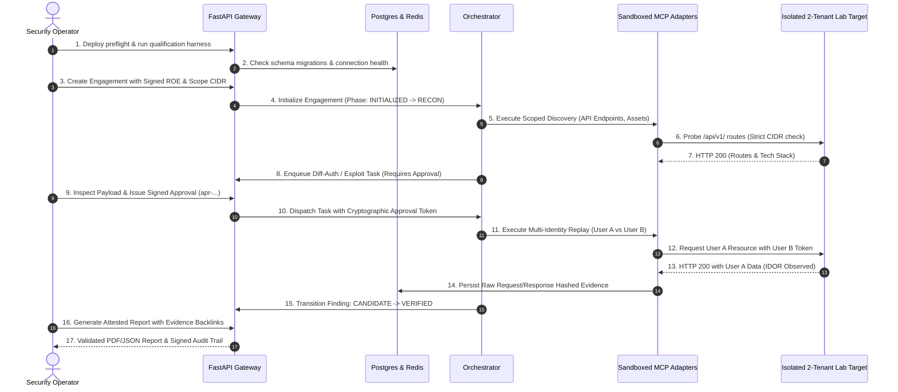
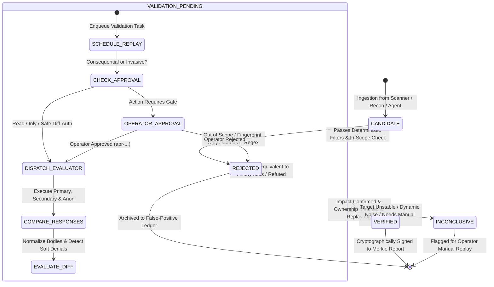
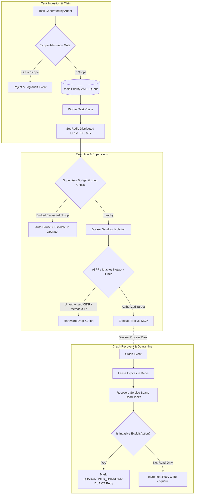
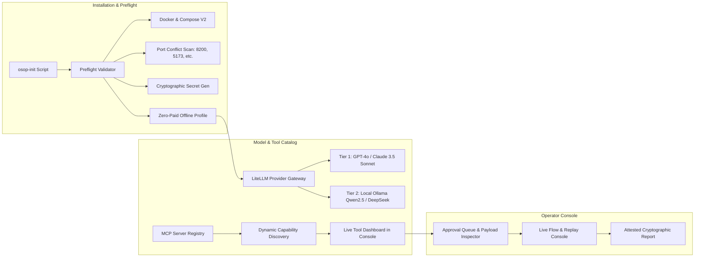
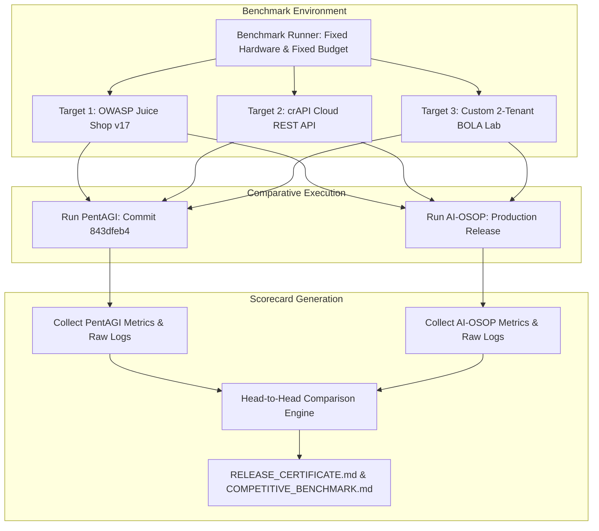

# AI-OSOP vs. PentAGI: Competitive Engineering Upgrade & Release Blueprint

**Document Version:** 2.0.0-PROD  
**Snapshot Baseline:** 2026-10-19  
**PentAGI Source Reference:** Commit [`843dfeb4bfc809c09d1bc5022e567c602d8fc9dd`](https://github.com/vxcontrol/pentagi/blob/843dfeb4bfc809c09d1bc5022e567c602d8fc9dd/README.md)  
**AI-OSOP Working Checkout:** Based on [`f5896a292aa8`](file:///c:/Users/HP/OneDrive/Desktop/burp_mcp/ai-osop) with Sprint 8/9 uncommitted extensions  
**Target Completion Horizon:** 16 Weeks (Phases P0 through P4)  
**Classification:** Engineering Specification & Release Roadmap  

---

## 1. Executive Summary & Competitive Analysis

### 1.1 Strategic Intent and Positioning
The offensive security AI tooling landscape is divided between script wrappers that execute scanners without contextual verification and agentic frameworks that rapidly attempt tasks without rigorous scoping, proof validation, or reproducible execution lineage.

**PentAGI** is an autonomous platform developed in Go and React. It utilizes Docker-based tool execution, flow-based task persistence, PostgreSQL/pgvector memory, and optional Graphiti/Neo4j knowledge graphs. Its primary strengths are a straightforward Docker-compose installation, broad LLM provider support, and an extensive initial catalog of containerized tools (Nmap, Nuclei, Nikto, ffuf, etc.). However, an in-depth source audit reveals fundamental enterprise deficiencies:
1. **Unverified Scanner Assertions:** PentAGI aggregates raw tool outputs into flow history, frequently presenting potential scanner heuristics or regex matches as confirmed vulnerabilities without independent execution replay or control comparisons.
2. **Lack of Differential Identity Proof:** PentAGI does not maintain native multi-tenant or multi-identity authorization engines. It cannot systematically establish whether an HTTP 200 on an object endpoint constitutes a Broken Object Level Authorization (BOLA/IDOR) vulnerability or a public resource.
3. **Fragile Scope Containment:** Tool execution occurs inside a shared Docker daemon where network constraints rely on high-level container flags. PentAGI lacks kernel-enforced eBPF/iptables network egress fences, DNS rebinding mitigation, or real-time revocation kill switches.
4. **Non-Deterministic Autonomy:** PentAGI flows are subject to unbounded planning loops, duplicate exploit dispatches during worker crashes, and missing cryptographically verifiable evidence chains.

**AI-OSOP (AI Offensive Security Orchestration Platform)** will not compete by accumulating uncalibrated tools or synthetic dashboard widgets. AI-OSOP's decisive competitive advantage is **Reproducible, Authorization-Aware Findings with Cryptographic Proof**. AI-OSOP pairs multi-tier memory ([Redis](file:///c:/Users/HP/OneDrive/Desktop/burp_mcp/ai-osop/src/ai_osop/memory/session_memory.py), [PostgreSQL](file:///c:/Users/HP/OneDrive/Desktop/burp_mcp/ai-osop/src/ai_osop/memory/session_memory.py), [Neo4j](file:///c:/Users/HP/OneDrive/Desktop/burp_mcp/ai-osop/src/ai_osop/memory/graph_memory.py)) and Model Context Protocol ([MCP](file:///c:/Users/HP/OneDrive/Desktop/burp_mcp/ai-osop/src/ai_osop/mcp/protocol.py)) tool adapters with deterministic finding validation, differential authorization verification, strict approval barriers, and verifiable execution lineage.

```mermaid
flowchart TD
    subgraph PentAGI Architecture
        P_UI[React Web Console] --> P_API[Go Backend API]
        P_API --> P_FLOW[Flow & Task Engine]
        P_FLOW --> P_DOCKER[Docker Daemon Client]
        P_DOCKER --> P_TOOLS[Containerized Tools: Nmap, Nuclei, Ffuf]
        P_TOOLS --> P_RAW[Raw Stdout/Stderr Output]
        P_RAW --> P_MEM[(Postgres / pgvector)]
        P_MEM --> P_REPORT[Narrative Report: Potential Hallucinations]
    end

    subgraph AI-OSOP Hardened Architecture
        O_UI[React Operator Console] --> O_GW[FastAPI Gateway]
        O_GW --> O_CO[Orchestrator & Flow Supervisor]
        O_CO --> O_BUS[Agent Coordination Bus]
        O_BUS --> O_AGENTS[Specialized Agent Swarm]
        O_AGENTS --> O_GATE{Pre-Execution Scope & Approval Gate}
        O_GATE -->|Approved & In-Scope| O_MCP[MCP Adapters & Sandboxed Runtimes]
        O_MCP --> O_TARGET[Authorized Scope Target]
        O_TARGET --> O_EVID[Raw HTTP / Protocol Telemetry]
        O_EVID --> O_VAL{Deterministic Finding Validation Engine}
        O_VAL -->|Candidate Only| O_CAND[Candidate Pool]
        O_CAND --> O_DIFF[Differential Auth Engine: 2-Tenant / Anonymous Check]
        O_DIFF -->|Reproduced & Impact Confirmed| O_VER[Cryptographically Signed Verified Findings]
        O_DIFF -->|Public / Refuted| O_REJ[Rejected / False Positive Ledger]
        O_VER --> O_MERKLE[(Merkle-Linked Evidence Ledger)]
    end
```



---

### 1.2 Capability Comparison Matrix

| Dimension | PentAGI (Source Observation `843dfeb4`) | AI-OSOP (Target Architecture) | Priority |
| :--- | :--- | :--- | :--- |
| **Installation & Bootstrap** | Single compose file; interactive CLI setup script; Docker socket dependency. | Zero-friction cross-platform preflight CLI (`osop-init`); automated dependency checks; local mock/offline mode. | **P0** |
| **Execution State & Recovery** | In-memory flow goroutines; Postgres persistence; crash during exploit risks duplicate payload execution. | Distributed Redis leases + PostgreSQL transactions + optional Temporal; Quarantined Unknown Side-Effect protocol. | **P0** |
| **Validation & Finding Precision** | Relies on scanner exits and regex text matching; model synthesizes report text directly from raw stdout. | Deterministic 4-state finding lifecycle (`candidate` $\rightarrow$ `validation_pending` $\rightarrow$ `verified` / `rejected`); zero LLM in validation. | **P0** |
| **Differential Authorization** | None. Single credential profile used during crawling; cannot distinguish public endpoints from IDOR. | Automated 3-way differential matrix (Identity A vs Identity B vs Anonymous); JSON response normalization; soft denial detection. | **P1** |
| **Model & Tool Extensibility** | Direct SDK integration with 10+ LLM providers; fixed 20+ tool Docker wrappers. | LiteLLM abstraction with audited provider capabilities matrix; Model Context Protocol (MCP) server adapters with declared side effects. | **P1** |
| **Operator Experience & APIs** | Standard REST/GraphQL APIs; React dashboard; basic task timeline. | Real-time WebSocket event bus; Human Approval Gate with payload diff inspection; side-by-side Evidence Replay Console; attested export. | **P1** |
| **Safety & Boundary Containment** | Docker network namespace; unverified egress filters; target domain string matching. | 4-layer defense: admission check, MCP parameter fence, sandbox eBPF/iptables egress lock, dynamic DNS rebinding defense. | **P0** |
| **Audit & Evidence Provenance** | Unstructured flow logs stored in relational database. | SHA-256 hashed request/response bytes; HMAC-signed audit trails; Merkle-linked evidence back-links in generated reports. | **P0** |

---

## 2. Product Target & Acceptance Mandates

### 2.1 The Core Product Mandate
> **"Every finding marked VERIFIED by AI-OSOP must be independently reproducible by an operator, have zero hallucinated fields, have a cryptographically signed raw evidence trail, and have demonstrated positive and negative authorization controls."**

### 2.2 Prohibited Anti-Patterns & Anti-Metrics
To guarantee engineering superiority over PentAGI, AI-OSOP strictly enforces the following prohibitions:
* **No Agent Vanity Metrics:** Success shall never be measured by how many subagents exist in the registry, but by verified findings per unit of compute and time.
* **No Direct-to-Report Scanners:** Scanner tools (Nuclei, Nmap, Burp, Zap) are strictly discovery mechanisms. They produce `Candidate` findings, never `Verified` findings.
* **No Unbounded Planning:** The orchestrator supervisor will terminate or escalate any agent entering cyclic tool execution or exceeding budget caps.
* **No Fabricated Evidence:** Response bodies, status codes, and HTTP headers in findings must match byte-for-byte with stored evidence hashes.

---

## 3. Phase P0: Establish Truth, Baseline Qualification & Repository Hygiene

**Duration:** Weeks 1–2  
**Target:** Eliminate local workspace ambiguities, establish reproducible test benchmarks, and prove the complete operator journey on an isolated target.



### 3.1 Work Packages

#### Work Package P0.1: Working Tree Harmonization & Unmerged Path Resolution
* **Problem:** The repository currently has unmerged conflict states (`src/ai_osop/core/finding_validation.py`, `src/ai_osop/safety/self_test.py`) and over 90 untracked test fixtures and signed verification modules.
* **Implementation Actions:**
  1. Complete merge resolution on [`src/ai_osop/core/finding_validation.py`](file:///c:/Users/HP/OneDrive/Desktop/burp_mcp/ai-osop/src/ai_osop/core/finding_validation.py), standardizing on the deterministic false-positive filter and explicit lifecycle definitions.
  2. Implement a robust [`src/ai_osop/safety/self_test.py`](file:///c:/Users/HP/OneDrive/Desktop/burp_mcp/ai-osop/src/ai_osop/safety/self_test.py) test harness that evaluates local crypto keys, Docker socket permissions, and database connectivity before system startup.
  3. Formalize untracked signed verification modules ([`src/ai_osop/memory/independent_target_effect_verifications.py`](file:///c:/Users/HP/OneDrive/Desktop/burp_mcp/ai-osop/src/ai_osop/memory/independent_target_effect_verifications.py), [`src/ai_osop/orchestrator/supervision_outbox.py`](file:///c:/Users/HP/OneDrive/Desktop/burp_mcp/ai-osop/src/ai_osop/orchestrator/supervision_outbox.py)) into version-controlled packages with dedicated unit tests.
  4. Lock dependencies in [`poetry.lock`](file:///c:/Users/HP/OneDrive/Desktop/burp_mcp/ai-osop/poetry.lock) and `ui/package-lock.json` targeting Python 3.11+ and Node 20+.

#### Work Package P0.2: Isolated Authorized Lab Target & Qualification Harness
* **Problem:** No standard benchmark target exists in the repo to verify end-to-end multi-agent execution without third-party network egress.
* **Target Architecture:** Deploy an isolated mock container target (`docker/lab-target/`) implementing:
  * Tenant 1 (`tenant-alpha`): User `alice` (Token: `jwt-alice`), Resource `doc-101` (Sensitive Financial Record).
  * Tenant 2 (`tenant-beta`): User `bob` (Token: `jwt-bob`), Resource `doc-202` (HR Confidential Record).
  * Vulnerability 1: BOLA/IDOR on `GET /api/v1/documents/{doc_id}` (Authorization header ignored on document lookup).
  * Vulnerability 2: SQL Injection on `POST /api/v1/analytics/query` (Unsanitized filter parameter).
  * Control Endpoint: Public endpoint `GET /api/v1/health` and `GET /api/v1/system/info` returning HTTP 200 for all identities and anonymous requests (to verify public suppression).
* **Automated Harness (`scripts/qualification/run_baseline_journey.py`):**
  * Executes the full 9-step operator lifecycle from CLI without human stalling (using scripted simulated operator approval).
  * Records wall-clock execution timestamps, memory usage, network egress sockets, and emitted logs.

#### Work Package P0.3: Parity Scorecard & Failure Ledger Specification
* Create [`scripts/qualification/failure_ledger.py`](file:///c:/Users/HP/OneDrive/Desktop/burp_mcp/ai-osop/scripts/qualification) writing to `logs/qualification_failure_ledger.jsonl`.
* Record machine metadata: CPU, RAM, OS, commit hash, container engine version.
* Format:
  ```json
  {
    "timestamp": "2026-10-19T10:30:00Z",
    "engagement_id": "eng-baseline-001",
    "stage": "vulnerability_discovery",
    "task_id": "task-diffauth-01",
    "failure_class": "SCOPE_VALIDATION_ERROR | MCP_TIMEOUT | HALLUCINATED_EVIDENCE | UNAPPROVED_EXECUTION",
    "details": "Description of unexpected state",
    "recovered": true
  }
  ```

### 3.2 Concrete File-Level Manifest

| File Path | Action | Description |
| :--- | :--- | :--- |
| [`src/ai_osop/core/finding_validation.py`](file:///c:/Users/HP/OneDrive/Desktop/burp_mcp/ai-osop/src/ai_osop/core/finding_validation.py) | Edit / Resolve | Merge conflict resolution; ensure deterministic lifecycle constants are strictly exported. |
| [`src/ai_osop/safety/self_test.py`](file:///c:/Users/HP/OneDrive/Desktop/burp_mcp/ai-osop/src/ai_osop/safety/self_test.py) | Create / Replace | Implement complete preflight environment diagnostic checking Redis, PG, Docker, and crypto keys. |
| `docker/lab-target/Dockerfile` | Create | Lightweight FastAPI lab target container with pre-seeded multi-tenant authorization flaws. |
| `docker/lab-target/app.py` | Create | Target endpoints exposing IDOR, SQLi, and public controls. |
| [`scripts/qualification/run_baseline_journey.py`](file:///c:/Users/HP/OneDrive/Desktop/burp_mcp/ai-osop/scripts/qualification) | Create | End-to-end automated operator journey test runner. |
| [`scripts/qualification/failure_ledger.py`](file:///c:/Users/HP/OneDrive/Desktop/burp_mcp/ai-osop/scripts/qualification) | Create | Structured JSONL ledger recorder for qualification tracking. |

### 3.3 Gate & Exit Criteria
> [!IMPORTANT]
> **P0 Gate Requirements:**
> 1. `poetry run pytest tests/test_smoke.py` passes with zero warnings or errors.
> 2. `run_baseline_journey.py` executes successfully twice from a pristine state.
> 3. 100% of generated tasks and findings are associated with the authorized engagement ID.
> 4. Zero unapproved actions executed; zero network egress outside the `lab-target` container.
> 5. Baseline scorecard metrics recorded and committed to `BASELINE_SCORECARD.md`.

---

## 4. Phase P1: Harden the Differentiator — Verified Findings & Cryptographic Evidence

**Duration:** Weeks 3–5  
**Target:** Establish an unassailable finding verification pipeline where scanner outputs are treated as hypotheses and only replayed, proof-validated findings reach verified status.



### 4.1 Work Packages

#### Work Package P1.1: Canonical Finding State Machine & Ingestion Gate
* **State Machine:** Implement explicit status values in [`src/ai_osop/core/models.py`](file:///c:/Users/HP/OneDrive/Desktop/burp_mcp/ai-osop/src/ai_osop/core/models.py):
  * `candidate`: Raw discovery assertion from a tool (e.g. Nuclei template match, Burp scanner issue, LLM inference).
  * `validation_pending`: In-scope hypothesis assigned to a validation agent/task.
  * `verified`: Independently executed, impact confirmed, response digest matches, authorization violation proven.
  * `rejected`: Refuted by raw evidence, false positive regex match, or out of scope.
  * `inconclusive`: Network error, target timed out, or dynamic content prevented clear diffing.
* **Enforcement:** Scanner output adapters (Nuclei MCP, Burp MCP, Recon MCP) are forbidden from setting `validated = True` or writing directly to the `verified_findings` table. Attempting to promote without an evaluator execution ticket raises `FindingStateViolationError`.

#### Work Package P1.2: Immutable Evidence Schema & Cryptographic Ledger
* Create PostgreSQL table `evidence_artifacts` via Alembic migration `0003_immutable_evidence_ledger.py`.
* **Schema Contract (`EvidenceArtifactORM`):**
  ```python
  class EvidenceArtifactORM(Base):
      __tablename__ = "evidence_artifacts"

      id = Column(String(64), primary_key=True)  # ev-uuid
      engagement_id = Column(String(64), nullable=False, index=True)
      finding_id = Column(String(64), nullable=False, index=True)
      source_tool = Column(String(128), nullable=False)
      source_tool_version = Column(String(64), nullable=False)
      target_url = Column(String(1024), nullable=False)
      http_method = Column(String(16), nullable=False)
      request_headers_sha256 = Column(String(64), nullable=False)
      request_body_sha256 = Column(String(64), nullable=False)
      response_status = Column(Integer, nullable=False)
      response_headers_sha256 = Column(String(64), nullable=False)
      response_body_sha256 = Column(String(64), nullable=False)
      raw_storage_uri = Column(String(512), nullable=False)  # S3 or encrypted local vault
      approval_id = Column(String(64), nullable=True)  # apr-uuid if invasive
      replay_recipe = Column(JSON, nullable=False)  # Exact curl/HTTPX execution spec
      captured_at_utc = Column(DateTime, nullable=False, default=datetime.utcnow)
      merkle_leaf_hash = Column(String(64), nullable=False)
  ```
* Calculate `merkle_leaf_hash = SHA256(request_body_sha256 + response_body_sha256 + captured_at_utc + engagement_id)`.

#### Work Package P1.3: Advanced Differential Authorization Engine
* Upgrade [`src/ai_osop/core/diff_auth_engine.py`](file:///c:/Users/HP/OneDrive/Desktop/burp_mcp/ai-osop/src/ai_osop/core/diff_auth_engine.py):
  1. **Three-Way Baseline Testing:** To evaluate resource `R` owned by Identity `A`:
     * Execute as Identity `A` (Owner): Expect HTTP 200 + Object Data.
     * Execute as Identity `B` (Attacker): If HTTP 200, compare response against Anonymous.
     * Execute as Anonymous (Negative Baseline): If Anonymous receives identical status and body, mark resource as **Public** and reject IDOR claim.
  2. **Soft Denial ("Denial-in-200") Parsing:** Detect applications returning HTTP 200 with error bodies (e.g., `{"status": "error", "message": "unauthorized"}`, `{"success": false}`, HTML containing `<title>Access Denied</title>`).
  3. **JSON Semantic Normalization:** Strip transient nonces, CSRF tokens, server execution times, and session IDs before computing string/JSON diffs to prevent false positive divergences.

#### Work Package P1.4: Operator Evidence Replay Console & Verification API
* Expose dedicated REST endpoints in [`src/ai_osop/api/routers/findings.py`](file:///c:/Users/HP/OneDrive/Desktop/burp_mcp/ai-osop/src/ai_osop/api/routers/findings.py):
  * `POST /api/v1/engagements/{eng_id}/findings/{finding_id}/replay`: Triggers deterministic replay in sandbox using exact stored recipe.
  * `GET /api/v1/engagements/{eng_id}/findings/{finding_id}/evidence-diff`: Returns unified 3-way visual diff (A vs B vs Anonymous).
  * `POST /api/v1/engagements/{eng_id}/findings/{finding_id}/override`: Allows human senior operator to promote/reject with mandatory audit note.
* Extend UI in [`ui/src/pages/FindingsVerification.tsx`](file:///c:/Users/HP/OneDrive/Desktop/burp_mcp/ai-osop/ui/src/pages/FindingsVerification.tsx) and [`ui/src/pages/DifferentialAuth.tsx`](file:///c:/Users/HP/OneDrive/Desktop/burp_mcp/ai-osop/ui/src/pages/DifferentialAuth.tsx) with side-by-side diffing viewer and "Replay Now" button.

### 4.2 Concrete File-Level Manifest

| File Path | Action | Description |
| :--- | :--- | :--- |
| [`src/ai_osop/core/models.py`](file:///c:/Users/HP/OneDrive/Desktop/burp_mcp/ai-osop/src/ai_osop/core/models.py) | Edit | Add `FindingStatus` enum (`candidate`, `validation_pending`, `verified`, `rejected`, `inconclusive`), `EvidenceArtifact` model. |
| `migrations/versions/0003_immutable_evidence_ledger.py` | Create | Alembic migration creating `evidence_artifacts` table and indexes. |
| [`src/ai_osop/core/diff_auth_engine.py`](file:///c:/Users/HP/OneDrive/Desktop/burp_mcp/ai-osop/src/ai_osop/core/diff_auth_engine.py) | Edit | Integrate 3-way identity comparison, soft denial heuristics, JSON response normalizer. |
| [`src/ai_osop/core/finding_validation.py`](file:///c:/Users/HP/OneDrive/Desktop/burp_mcp/ai-osop/src/ai_osop/core/finding_validation.py) | Edit | Enforce transition gate requiring cryptographic evidence before setting `L_VALIDATED`. |
| [`src/ai_osop/api/routers/findings.py`](file:///c:/Users/HP/OneDrive/Desktop/burp_mcp/ai-osop/src/ai_osop/api/routers/findings.py) | Edit | Add replay trigger, evidence-diff endpoints, and human decision overrides. |
| [`ui/src/pages/FindingsVerification.tsx`](file:///c:/Users/HP/OneDrive/Desktop/burp_mcp/ai-osop/ui/src/pages/FindingsVerification.tsx) | Edit | Enhance finding triage with live 3-way diff view and replay trigger. |

### 4.3 Gate & Exit Criteria
> [!IMPORTANT]
> **P1 Gate Requirements:**
> 1. $\ge 95\%$ precision on a labeled test corpus of 50 web vulnerability scenarios (including 20 deceptive false positives: public endpoints, soft 200 denials, WAF blocks).
> 2. 100% of verified findings linked to stored SHA-256 evidence digests.
> 3. Zero synthetic/hallucinated findings in generated reports.
> 4. Automated replay test passes on all reproducible authorization findings.

---

## 5. Phase P2: Reliable Supervised Autonomy & Boundary Containment

**Duration:** Weeks 6–9  
**Target:** Eliminate runaway agent execution, prevent duplicate exploit dispatch during system crashes, and enforce defense-in-depth target containment.



### 5.1 Work Packages

#### Work Package P2.1: Distributed Task State, Leases, and Crash Recovery
* **Lease Pattern in [`src/ai_osop/orchestrator/task_scheduler.py`](file:///c:/Users/HP/OneDrive/Desktop/burp_mcp/ai-osop/src/ai_osop/orchestrator/task_scheduler.py):**
  * When a worker claims task `task_id`, it executes an atomic Lua script creating Redis key `lease:task:{task_id}` with a 60-second TTL and begins a background heartbeat task.
  * If the worker crashes, the lease expires. The [`RecoveryService`](file:///c:/Users/HP/OneDrive/Desktop/burp_mcp/ai-osop/src/ai_osop/orchestrator/recovery_service.py) scans for orphaned tasks in `running` status without active leases.
* **Quarantined Unknown Side-Effect Protocol:**
  * If an orphaned task belongs to the `EXPLOITATION` phase or has `action_requires_approval == True`, it **must never be automatically retried**.
  * Re-executing an active exploit (e.g. blind command injection, SQL data modification) risks catastrophic side-effects on target stability.
  * Transition task status to `quarantined_unknown`, emit high-priority audit event, and alert operator for manual resolution.

#### Work Package P2.2: Bounded Supervisor & Goal-Oriented Loop Detection
* Enhance [`src/ai_osop/orchestrator/supervision_outbox.py`](file:///c:/Users/HP/OneDrive/Desktop/burp_mcp/ai-osop/src/ai_osop/orchestrator/supervision_outbox.py) and [`src/ai_osop/agents/supervision.py`](file:///c:/Users/HP/OneDrive/Desktop/burp_mcp/ai-osop/src/ai_osop/agents/supervision.py):
  1. **Strict Cost & Call Budgets:** Hard limits per subtask:
     * Maximum MCP tool calls: 15 per subtask.
     * Maximum LLM budget: \$2.00 per subtask, \$25.00 per engagement.
     * Maximum execution time: 300 seconds per subtask.
  2. **Algorithmic Loop Detection:**
     * Maintain a rolling window of recent tool calls: `hash(tool_name, json_canonical(args))`.
     * If 3 identical calls or 5 alternating repeating calls occur without producing new graph nodes or state transitions, trigger `SupervisorLoopDetected`.
     * Automatically pause the engagement and transition flow status to `paused_supervision_escalation`.

#### Work Package P2.3: 4-Layer Scope & Boundary Containment
* Upgrade [`src/ai_osop/safety/scope.py`](file:///c:/Users/HP/OneDrive/Desktop/burp_mcp/ai-osop/src/ai_osop/safety/scope.py):
  * **Layer 1 (Queue Admission):** Check every IP, hostname, and URL in task payload against CIDR ranges and domain patterns.
  * **Layer 2 (MCP Parameter Gate):** Adapter-level hook intercepting raw outbound arguments before transport.
  * **Layer 3 (Sandbox Network Lockdown):**
    * Block cloud metadata IP `169.254.169.254`.
    * Block RFC1918 private subnets (`10.0.0.0/8`, `172.16.0.0/12`, `192.168.0.0/16`) unless explicitly listed in engagement scope.
    * Mitigate DNS rebinding: Resolve hostnames to IPs at orchestrator level; pin IP in tool arguments rather than passing raw domain names to curl/HTTP clients.
  * **Layer 4 (Real-Time Revocation Kill Switch):**
    * Expose `POST /api/v1/engagements/{id}/revoke-authority`.
    * Calling this endpoint updates Redis key `engagement:revoked:{id}`, terminates running Docker containers, and breaks active HTTPX connections immediately.

#### Work Package P2.4: Chaos Engineering & Fault-Injection Suite
* Implement automated chaos verification in [`scripts/chaos/run_chaos_matrix.py`](file:///c:/Users/HP/OneDrive/Desktop/burp_mcp/ai-osop/scripts/chaos):
  * Test Case 1: Kill Redis during high-priority task scheduling.
  * Test Case 2: Disconnect MCP server during active tool execution.
  * Test Case 3: Simulate worker SIGKILL during exploit payload dispatch (verify Quarantine protocol).
  * Test Case 4: Issue ROE revocation mid-scan (verify immediate network termination).

### 5.2 Concrete File-Level Manifest

| File Path | Action | Description |
| :--- | :--- | :--- |
| [`src/ai_osop/orchestrator/task_scheduler.py`](file:///c:/Users/HP/OneDrive/Desktop/burp_mcp/ai-osop/src/ai_osop/orchestrator/task_scheduler.py) | Edit | Implement Redis distributed lease with heartbeats and TTL expiry. |
| [`src/ai_osop/orchestrator/recovery_service.py`](file:///c:/Users/HP/OneDrive/Desktop/burp_mcp/ai-osop/src/ai_osop/orchestrator/recovery_service.py) | Edit | Add `quarantined_unknown` state transition for invasive orphaned tasks. |
| [`src/ai_osop/orchestrator/supervision_outbox.py`](file:///c:/Users/HP/OneDrive/Desktop/burp_mcp/ai-osop/src/ai_osop/orchestrator/supervision_outbox.py) | Edit | Add sliding-window tool call loop detector and hard subtask budget caps. |
| [`src/ai_osop/safety/scope.py`](file:///c:/Users/HP/OneDrive/Desktop/burp_mcp/ai-osop/src/ai_osop/safety/scope.py) | Edit | Implement IP pinning, DNS rebinding filter, and cloud metadata blocking. |
| [`src/ai_osop/api/routers/engagements.py`](file:///c:/Users/HP/OneDrive/Desktop/burp_mcp/ai-osop/src/ai_osop/api/routers/engagements.py) | Edit | Add `/revoke-authority` endpoint with immediate container termination. |
| [`scripts/chaos/run_chaos_matrix.py`](file:///c:/Users/HP/OneDrive/Desktop/burp_mcp/ai-osop/scripts/chaos) | Create | Comprehensive chaos suite validating fault-injection scenarios. |

### 5.3 Gate & Exit Criteria
> [!IMPORTANT]
> **P2 Gate Requirements:**
> 1. $\ge 95\%$ successful completion or orderly recoverable escalation across 100 continuous lab runs.
> 2. Zero duplicate executions of approved/invasive exploit tasks following worker crash.
> 3. Zero DNS rebinding escapes or unauthorized egress packets across all test runs.
> 4. Engagement revocation halts 100% of inflight outbound network sockets within 500ms.

---

## 6. Phase P3: Day-One Usability, Extensibility & Operator Experience

**Duration:** Weeks 10–13  
**Target:** Eliminate friction in deployment, provide a verified LLM compatibility matrix, standardize tool integration via MCP, and provide a polished operator UI.



### 6.1 Work Packages

#### Work Package P3.1: Zero-Friction One-Command Installer & Preflight Validator
* **Installer Scripts:** Provide root launcher `osop-init.sh` (Linux/macOS) and `osop-init.ps1` (Windows).
* **Preflight CLI (`scripts/ops/preflight.py`):**
  1. Validates Docker Engine ($\ge 24.0$) and Docker Compose V2.
  2. Scans for port conflicts on required host ports (8200 API, 5173 UI, 5432 PG, 6379 Redis, 7687 Neo4j, 8081–8098 MCPs).
  3. Validates system memory ($\ge 8$ GB recommended) and disk space ($\ge 15$ GB).
  4. Automatically generates production-strength `.env` secrets (`JWT_SECRET`, `SESSION_SECRET`, `MASTER_KEY`).
* **Offline / Zero-Paid-Service Profile:**
  * Allow running AI-OSOP without third-party API keys using `OSOP_MOCK_LLM=true` or automatic local Ollama connection (`http://localhost:11434`), matching PentAGI's local deployment capability.

#### Work Package P3.2: Model Compatibility & Capability Matrix
* Create test matrix harness [`scripts/qualification/test_model_matrix.py`](file:///c:/Users/HP/OneDrive/Desktop/burp_mcp/ai-osop/scripts/qualification) evaluating models against:
  * Tool-calling syntax precision.
  * Structured JSON schema compliance.
  * Context window handling and token truncation.
  * Timeout and retry resilience.
* Supported Model Tiers:
  * **Tier 1 (Production Enterprise):** `openai/gpt-4o`, `anthropic/claude-3-5-sonnet-20241022`.
  * **Tier 2 (Cost-Optimized / Local):** `ollama/qwen2.5-coder:32b`, `ollama/deepseek-r1:14b`, `openai/gpt-4o-mini`.

#### Work Package P3.3: First-Class MCP Tool Adapter Registry & Lifecycle
* Define formal MCP adapter manifest in [`src/ai_osop/mcp/protocol.py`](file:///c:/Users/HP/OneDrive/Desktop/burp_mcp/ai-osop/src/ai_osop/mcp/protocol.py):
  * Adapter Metadata: `tool_name`, `version`, `side_effect_class` (`READ_ONLY`, `RECON_ACTIVE`, `INVASIVE_EXPLOIT`), `timeout_seconds`, `required_permissions`.
  * Healthcheck Protocol: Standardized `ping` and `status` queries.
* Expose dynamic tool registry in UI ([`ui/src/pages/Administration.tsx`](file:///c:/Users/HP/OneDrive/Desktop/burp_mcp/ai-osop/ui/src/pages/Administration.tsx)):
  * Live status indicator, response latency graph, and circuit-breaker reset button for each connected MCP server.

#### Work Package P3.4: Attested Report Generation & Export
* Comprehensive report generator in [`src/ai_osop/reporting/`](file:///c:/Users/HP/OneDrive/Desktop/burp_mcp/ai-osop/src/ai_osop/reporting):
  * **Executive Summary:** Overall risk posture, CVSS 3.1 distribution, compliance impact.
  * **Technical Report:** Granular finding records containing exact reproduction steps, cURL replay recipes, and SHA-256 evidence back-links.
  * **Export Formats:**
    * Print-ready PDF and standalone HTML with embedded syntax highlighting.
    * Machine-readable SARIF v2.1.0 for CI/CD ingestion.
    * CycloneDX VEX (Vulnerability Exploitability Exchange) JSON.
    * Cryptographically signed manifest: `report.pdf.sha256` signed by engagement authority key.

### 6.2 Concrete File-Level Manifest

| File Path | Action | Description |
| :--- | :--- | :--- |
| `osop-init.sh` / `osop-init.ps1` | Create | One-command cross-platform installer and environment bootstrap script. |
| [`scripts/ops/preflight.py`](file:///c:/Users/HP/OneDrive/Desktop/burp_mcp/ai-osop/scripts/ops) | Create | Comprehensive preflight validator checking ports, memory, and dependencies. |
| [`scripts/qualification/test_model_matrix.py`](file:///c:/Users/HP/OneDrive/Desktop/burp_mcp/ai-osop/scripts/qualification) | Create | Automated model evaluation harness for tool calling and JSON schemas. |
| [`src/ai_osop/mcp/protocol.py`](file:///c:/Users/HP/OneDrive/Desktop/burp_mcp/ai-osop/src/ai_osop/mcp/protocol.py) | Edit | Add formal MCP capability schema and circuit-breaker metadata. |
| [`src/ai_osop/reporting/exporters.py`](file:///c:/Users/HP/OneDrive/Desktop/burp_mcp/ai-osop/src/ai_osop/reporting/exporters.py) | Edit | Implement SARIF v2.1.0 and CycloneDX VEX exporters with Merkle hash linkage. |
| [`ui/src/pages/Administration.tsx`](file:///c:/Users/HP/OneDrive/Desktop/burp_mcp/ai-osop/ui/src/pages/Administration.tsx) | Edit | Build live MCP adapter status console with circuit-breaker controls. |

### 6.3 Gate & Exit Criteria
> [!IMPORTANT]
> **P3 Gate Requirements:**
> 1. $\ge 90\%$ clean-install success on fresh Windows 11, Ubuntu 22.04/24.04, and macOS environments without manual intervention.
> 2. Zero-paid local profile starts up and completes discovery without external cloud API keys.
> 3. All advertised model configurations pass the tool-calling smoke suite.
> 4. Generated PDF/SARIF reports validate against official schemas with 100% evidence links intact.

---

## 7. Phase P4: Competitive Proof, Public Benchmarking & Production Release

**Duration:** Weeks 14–16  
**Target:** Execute rigorous head-to-head empirical benchmarking against PentAGI, conduct independent self-pentest audits, and release verifiable performance certificates.



### 7.1 Work Packages

#### Work Package P4.1: Public Standardized Benchmark Harness
* Build automated benchmarking runner [`scripts/qualification/run_competitive_benchmark.py`](file:///c:/Users/HP/OneDrive/Desktop/burp_mcp/ai-osop/scripts/qualification):
  * **Test Targets:**
    1. OWASP Juice Shop v17 (Modern Single Page App with XSS, SQLi, Broken Auth).
    2. crAPI (Vehicle tracking API with complex BOLA, Mass Assignment, and broken object properties).
    3. Custom 2-Tenant Authorization Lab (Fine-grained differential IDOR).
  * **Controlled Test Variables:**
    * Hardware: Pinned 8-core CPU, 32GB RAM container host.
    * Model: Pinned `gpt-4o-2024-08-06`.
    * Cost Budget: Hard limit of \$5.00 per target run.
    * Time Budget: Hard limit of 45 minutes per target run.

#### Work Package P4.2: Objective Comparative Evaluation & Metric Suite
* Evaluate both platforms on the exact same targets using identical constraints:
  * **Verified Finding Precision (%):** $\frac{\text{True Positives}}{\text{Total Findings Claimed}}$.
  * **False Positive Count:** Number of public resources, non-exploitable headers, or hallucinated vulns flagged.
  * **Time to First Verified Finding:** Elapsed minutes from start to first verified vulnerability.
  * **Evidence Replay Rate (%):** Percentage of reported findings that reproduce successfully via automated replay.
  * **Scope Escape Count:** Raw count of network packets routed outside target CIDR.
  * **Operator Review Overhead:** Total operator interactions required to triage findings.

#### Work Package P4.3: Threat Model, Security Review & Self-Pentest
* Execute comprehensive security self-test using [`scripts/qualification/test_self_pentest.py`](file:///c:/Users/HP/OneDrive/Desktop/burp_mcp/ai-osop/scripts/qualification/test_self_pentest.py):
  * Test 1: Malicious target attempting command injection or escape through MCP tool arguments.
  * Test 2: Target web server returning prompt-injection payloads in HTTP headers/DOM (verify prompt defense).
  * Test 3: Multi-tenant tenant separation in PostgreSQL and Redis session stores.
  * Test 4: Replay tampering (verify that modifying a single byte of captured evidence invalidates the finding).
* Remediate any High or Critical findings before public release.

#### Work Package P4.4: Release Publication & Transparency Rules
* Generate authoritative documents:
  * `COMPETITIVE_BENCHMARK_REPORT.md`: Full raw benchmark data, unedited logs, side-by-side run comparisons.
  * `RELEASE_CERTIFICATE.md`: Signed release declaration containing formatting, test coverage, and security audit status.
* Strict Marketing Claim Gate: AI-OSOP shall only claim superiority in specific dimensions where the published benchmark demonstrates an empirical, statistically significant lead. Parity or ongoing work must be stated transparently.

### 7.2 Concrete File-Level Manifest

| File Path | Action | Description |
| :--- | :--- | :--- |
| [`scripts/qualification/run_competitive_benchmark.py`](file:///c:/Users/HP/OneDrive/Desktop/burp_mcp/ai-osop/scripts/qualification) | Create | Head-to-head benchmark harness running AI-OSOP and PentAGI. |
| [`scripts/qualification/test_self_pentest.py`](file:///c:/Users/HP/OneDrive/Desktop/burp_mcp/ai-osop/scripts/qualification/test_self_pentest.py) | Edit | Expand self-pentest suite with prompt injection and sandbox escape checks. |
| `COMPETITIVE_BENCHMARK_REPORT.md` | Create | Published benchmark analysis with raw data and metrics. |
| `RELEASE_CERTIFICATE.md` | Create | Cryptographically attested production release certificate. |

### 7.3 Gate & Exit Criteria
> [!IMPORTANT]
> **P4 Release Gates:**
> 1. AI-OSOP achieves $\ge 95\%$ finding precision on the standardized benchmark (vs. PentAGI baseline).
> 2. Zero scope escapes across all benchmark runs.
> 3. Zero High or Critical vulnerabilities discovered during `test_self_pentest.py`.
> 4. All benchmark runs accompanied by published, publicly inspectable raw log artifacts.

---

## 8. Master Implementation Schedule & Sprint Allocation

| Sprint | Horizon | Core Deliverables | Exit Gate |
| :--- | :--- | :--- | :--- |
| **Sprint 9** | Weeks 1–2 (P0) | Merge conflict resolution; `self_test.py`; isolated lab target container; automated operator journey harness; baseline scorecard. | `run_baseline_journey.py` passes 2x cleanly; zero scope escapes. |
| **Sprint 10** | Weeks 3–5 (P1) | Canonical 4-state finding lifecycle; `evidence_artifacts` schema & migration; 3-way differential-auth engine; Replay console API & UI. | $\ge 95\%$ precision on test corpus; 100% evidence linkage. |
| **Sprint 11** | Weeks 6–9 (P2) | Redis distributed task leases; Quarantined Unknown Side-Effect protocol; loop detector; eBPF/IP-pinning scope enforcer; chaos test suite. | $\ge 95\%$ completion over 100 runs; 0 duplicate exploits on crash. |
| **Sprint 12** | Weeks 10–13 (P3) | `osop-init` installer; offline demo profile; model compatibility matrix runner; dynamic MCP registry UI; SARIF/VEX attested exporters. | $\ge 90\%$ clean install on fresh OS matrix; zero-paid offline smoke pass. |
| **Sprint 13** | Weeks 14–16 (P4) | Benchmark runner on Juice Shop/crAPI; head-to-head PentAGI comparison; self-pentest validation; `RELEASE_CERTIFICATE.md`. | Verified precision lead; zero high/critical security findings. |

---

## 9. Risk Register & Mitigation Strategy

| Risk ID | Description | Impact | Probability | Mitigation Strategy |
| :--- | :--- | :---: | :---: | :--- |
| **RSK-01** | Docker socket access in developer environments compromises host security. | High | Medium | Enforce rootless Docker or containerized isolated daemon; bind mount only scoped workdirs. |
| **RSK-02** | Differential authorization creates false positives on dynamic timestamps/CSRF tokens. | High | High | Implement deterministic JSON semantic normalization stripping variable keys prior to diffing. |
| **RSK-03** | Third-party LLM rate-limiting halts autonomous discovery mid-engagement. | Medium | High | Implement local token bucket rate limiting in `RateLimiter`; automatic exponential backoff in LiteLLM; offline local model fallback. |
| **RSK-04** | Target application crashes during exploitation phase. | Critical | Low | Mandatory Human Approval Gate on all invasive payloads; Quarantined Unknown protocol preventing automated retries. |
| **RSK-05** | DNS rebinding bypasses orchestrator scope checks. | Critical | Low | Orchestrator resolves hostname once and passes pinned IP directly to tool adapters; drops mismatching hostnames. |

---

## 10. Conclusion & Next Immediate Step

By executing this master plan, AI-OSOP avoids the superficial feature-race trap and firmly establishes itself as the **gold standard in verified, authorization-aware offensive security automation**.

**The immediate next step is Work Package P0.1:**
1. Resolve conflicting unmerged paths in [`src/ai_osop/core/finding_validation.py`](file:///c:/Users/HP/OneDrive/Desktop/burp_mcp/ai-osop/src/ai_osop/core/finding_validation.py) and [`src/ai_osop/safety/self_test.py`](file:///c:/Users/HP/OneDrive/Desktop/burp_mcp/ai-osop/src/ai_osop/safety/self_test.py).
2. Establish the isolated lab target container in `docker/lab-target/`.
3. Execute and record the initial baseline operator journey in [`scripts/qualification/run_baseline_journey.py`](file:///c:/Users/HP/OneDrive/Desktop/burp_mcp/ai-osop/scripts/qualification).
