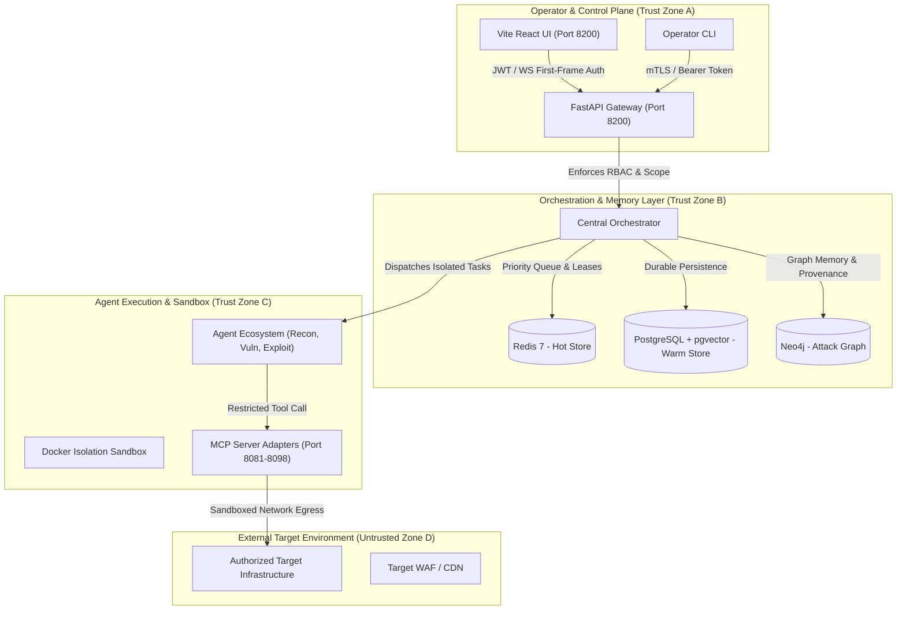

# AI-OSOP Threat Model & Security Architecture

**Document Version:** 1.0.0  
**Framework:** STRIDE (Spoofing, Tampering, Repudiation, Information Disclosure, Denial of Service, Elevation of Privilege)  
**Standard:** NIST SP 800-53 Rev. 5, OWASP Top 10 for LLM Applications (2025)  
**Target Architecture:** AI Offensive Security Orchestration Platform (AI-OSOP)  

---

## 1. System Overview & Trust Boundaries

The AI Offensive Security Orchestration Platform coordinates multi-agent autonomous testing pipelines against enterprise targets. Because the system generates, validates, and executes offensive security payloads, maintaining strict isolation, containment, and boundary integrity is paramount.

### Trust Boundary Definitions

1. **Boundary 1 (Operator $\leftrightarrow$ Gateway):** External operator boundary. Validated by cryptographic JWT validation (mandatory `exp`, `sub`, signed via asymmetric RS256/ES256 or pinned HS256 keys), RBAC role gating (`operator` vs `senior_operator`), and WebSocket first-frame token authentication.
2. **Boundary 2 (Gateway $\leftrightarrow$ Core Engine):** Internal orchestration boundary. Tasks cannot be enqueued or altered without passing scope enforcers and immutable Rules of Engagement (ROE) cryptographic binding.
3. **Boundary 3 (Agent $\leftrightarrow$ MCP Server Adapters):** Execution boundary. Tools communicate over isolated localhost HTTP / JSON-RPC loops. Circuit breakers and rate limiters constrain remote tool invocation volume.
4. **Boundary 4 (MCP Sandbox $\leftrightarrow$ External Target):** Target egress boundary. Confined strictly to authorized domains and IP subnets defined in `ScopeDefinition`. Pods run with `automountServiceAccountToken: false` to prevent Kubernetes control-plane traversal.

---

## 2. STRIDE Threat Analysis Matrix

| STRIDE Category | Threat Description | Attack Vector | Security Controls & Remediation Architecture | Verifying Suite |
| :--- | :--- | :--- | :--- | :--- |
| **Spoofing** | Operator Identity Forgery | JWT `alg=none` attack, expired token reuse, or missing `exp` claim bypass | `verify_token()` enforces `require_exp=True`, `verify_exp=True`, and explicit algorithm allowlists. Rejects `alg=none`. | `test_security.py` |
| **Spoofing** | WebSocket Stream Impersonation | Replaying unauthenticated WS connections or leaking bearer tokens in query string URLs | Enforced first-frame authentication (`{"type": "auth", "token": "..."}`). Tokens in query strings are rejected. | `test_websocket_first_frame_auth.py` |
| **Spoofing** | Agent / Provider Result Spoofing | Rogue worker fabricating scan findings or exploit verifications | Ed25519 signature binding on provider receipts and Merkle cryptographic tree linking. | `test_target_finding_evidence_20261016.py` |
| **Tampering** | Scope & Target Injection | Adding shell delimiters (`;`, `\|`, `&`, `$`, `` ` ``) or path traversal (`../`) in target URLs | `ScopeEnforcer` evaluates strict domain / CIDR membership, canonicalizes URLs, and drops injection characters. | `test_self_pentest.py` |
| **Tampering** | Evidence Log Tampering | Altering discovered vulnerability proof-of-concept payloads in post-exploitation | Findings linked into immutable SHA-256 Merkle leaf nodes. 1-byte alteration triggers cryptographic verification failure. | `test_self_pentest.py` |
| **Tampering** | Attack Graph Node Manipulation | Injecting cross-tenant edges into Neo4j graph storage | Multi-tenant tenant-scoped Cypher queries and engagement isolation fences. | `test_tenant_scoped_graph_traversal_20261018.py` |
| **Repudiation** | Destructive Action Denial | Operator denying authorization of intrusive exploit attempt | Mandatory Human-in-the-Loop (HITL) approval gate (`ApprovalRequest`), signed audit events (`AuditEvent`), and correlation IDs. | `test_temporal_approval_dispatch.py` |
| **Repudiation** | Engagement State Alteration | Untracked transition between engagement phases | Phase transition state machine (`Orchestrator.VALID_TRANSITIONS`) records timestamped audit transitions in PostgreSQL. | `test_engagement_transition_error.py` |
| **Information Disclosure** | Cross-Tenant Data Leaks | User A querying User B's engagements, tasks, or findings | Multi-tenant ownership enforcement via `assert_engagement_access` denying non-owners (HTTP 403). | `test_ownership.py` |
| **Information Disclosure** | Prometheus Label Cardinality & Secret Leak | High-cardinality UUIDs or access tokens exposed in Prometheus metrics labels | `PrometheusMetricsMiddleware` normalizes paths to endpoint route templates (`/engagements/{session_id}`). | `test_observability_middleware.py` |
| **Information Disclosure** | Memory / Session Dumping | Reading unencrypted session secrets or authorization cookies in persistent store | `OSOP_SESSION_ENCRYPTION_KEY` enforced in production. AES-GCM encryption of cookies and bearer credentials. | `test_security.py` |
| **Denial of Service** | MCP Provider Crash Loops | Broken or overwhelmed tool adapter hanging the orchestrator loop | Resilience circuit breaker: trips open after 5 failures, transitions to half-open after 30s probe period. | `test_reliability.py`, `run_chaos.py` |
| **Denial of Service** | Task Queue Saturation | Malicious or runaway task burst exhausting orchestrator threads | Redis sorted-set priority queue, Dead Letter Queue (DLQ) with exponential backoff (`@with_retry`), and HPA scaling. | `test_scale.py` |
| **Denial of Service** | Kubernetes Pod Eviction Downtime | Maintenance node drain terminating all active orchestrator replicas | PodDisruptionBudget (`minAvailable: 1`) guarantees continuous platform availability during maintenance. | `k8s/pdb.yaml` |
| **Elevation of Privilege** | RBAC Role Bypass | Regular `operator` performing admin tasks or approving dangerous actions | Strict dependency injection (`require_role("senior_operator")`) blocking unauthorized operations with HTTP 403. | `test_security.py` |
| **Elevation of Privilege** | LLM Prompt Injection | Untrusted target DOM content or HTTP headers overriding agent instructions | `PromptDefense` sanitizes external input, isolates untrusted context with boundary markers, and strips command prefixes. | `test_self_pentest.py` |
| **Elevation of Privilege** | Kubernetes ServiceAccount Escape | Compromised agent container querying Kubernetes API server | `automountServiceAccountToken: false` set on all pod specs, eliminating in-cluster service account credential access. | `k8s/agent-deployment.yaml`, `k8s/orchestrator-deployment.yaml` |

---

## 3. Defense-in-Depth Control Details

### 3.1 Authentication & Token Lifecycle (JWT Hardening)
- **Claim Enforcement:** All bearer tokens must contain `sub`, `exp`, and `role`. Tokens lacking `exp` are rejected immediately with HTTP 401.
- **Algorithm Pinning:** Explicit allowlists prevent algorithmic downgrade attacks (e.g., rejecting `none`, `symmetric` when configured for `asymmetric`).
- **Secret Hygiene:** Production environment validates that `OSOP_JWT_SECRET` meets minimum entropy requirements (minimum 32 bytes) and rejects default/test secrets.

### 3.2 Human-in-the-Loop (HITL) Approval Architecture
High-risk offensive actions (such as automated exploit payloads, reverse shell execution, or high-volume intrusive fuzzing) cannot execute autonomously:
1. Agent emits an `ApprovalRequest` specifying the exact target URL, payload, risk severity, and rollback strategy.
2. The orchestrator halts execution for that subtask branch and enters the `waiting_approval` state.
3. The Vite React console alerts senior operators in real-time over WebSocket.
4. Only users with role `senior_operator` can invoke the `/approvals/{id}/resolve` endpoint. Regular operators receive HTTP 403 Forbidden.

### 3.3 Scope & Egress Containment
The `ScopeEnforcer` engine enforces mathematical target containment:
- **FQDN Validation:** Target host must match defined domain wildcards or explicit domain lists.
- **IP / CIDR Membership:** Resolved IP addresses must belong to authorized CIDR blocks (`ip_network`). Private internal IPs (e.g. AWS metadata `169.254.169.254`, loopback `127.0.0.1`) are denied by default unless explicitly within scope.
- **Exclusion List Priority:** Exclusions take absolute precedence over inclusions.

---

## 4. Continuous Verification & Security Qualification

The platform validates this threat model through automated tests executed on every build:

1. **Adversarial Self-Pentest (`scripts/qualification/test_self_pentest.py`):**
   - Injects command injection payloads, path traversal patterns, prompt injection vectors, and 1-byte corrupted Merkle proofs.
   - Evaluates API boundaries for SQL injection and secret leakage.
2. **Security Qualification (`scripts/qualification/test_security.py`):**
   - Validates expired tokens, algorithm downgrade attempts, missing `exp` claims, RBAC permissions, and production encryption enforcement.
3. **Multi-Tenant Ownership Qualification (`scripts/qualification/test_ownership.py`):**
   - Asserts isolation between concurrent operator tenants for engagements, tasks, approvals, and sessions.
4. **Chaos Engineering Matrix (`scripts/chaos/run_chaos.py`):**
   - Simulates Redis process kills, Postgres failovers, and MCP crash loops to verify system degradation and circuit breaker recovery.
5. **Scale & Concurrency Benchmarking (`scripts/qualification/test_scale.py`):**
   - Sustains 1,000+ req/sec API throughput and concurrent task queue scheduling without deadlocks or race conditions.

---

*Verified and aligned with production readiness gate standards.*
